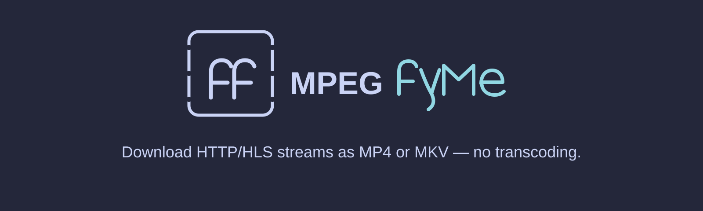

# ffmpegfyMe



**Download HTTP/HLS streams as MP4 or MKV — no transcoding.**

ffmpegfyMe is a Python CLI that wraps FFmpeg to download HTTP/HTTPS media streams, commonly HLS playlists, into local MP4 or MKV files.

## Implemented capabilities

- Interactive or batch Python CLI.
- HTTP/HTTPS inputs; playlist segments may use HTTP, HTTPS, TCP, TLS, or crypto via the FFmpeg protocol whitelist.
- MP4 or MKV outputs via FFmpeg stream copy (`-c copy`); no transcoding.
- Optional HTTP header or cookie auth with exact `${ENV_NAME}` references from a git-ignored `.env`.
- Saved per-item progress; completed items are skipped on rerun.
- Initial attempt plus up to two retries.
- 60 second default inactivity timeout, reset by FFmpeg output; no total timeout by default.

Every capability listed here is implemented. Planned work is tracked in GitHub Issues and may not be available.

## Prerequisites

**Docker quick start** (for the shown `task` commands):

- Docker Engine + Docker Compose
- Task

**Direct local use** (only):

- Python 3.11+
- FFmpeg installed and on `PATH`

## Quick start

```bash
task docker:build
task ffmpegfy:run
```

Before running, add one or more JSON manifests to in/; the minimal example below shows the required fields. For direct local use from the repository root, run python3 ffmpegfyMe.py.

## Minimal manifest

```json
[
    {
        "url": "https://cdn.example.com/video1.m3u8",
        "output": "video1.mp4"
    }
]
```

## Authentication

Protected sources may require HTTP header or cookie auth.

Auth values use exact environment references such as `${API_TOKEN}` or `${SESSION_COOKIE}`.

References must be exact `${ENV_NAME}` values; prefixed values such as `Bearer ${API_TOKEN}` are invalid.

The optional `headers` and `cookies` fields may be omitted for unauthenticated sources.

```json
[
    {
        "url": "https://cdn.example.com/video1.m3u8",
        "output": "video1.mp4",
        "headers": {
            "Authorization": "${API_TOKEN}"
        },
        "cookies": "${SESSION_COOKIE}"
    }
]
```

Credentials live in a git-ignored `.env` and are injected via `env_file` for Docker; direct local runs need the variables exported in the process environment.

Displayed FFmpeg output and error lines redact HTTP(S) URLs and resolved header/cookie values. Progress state stores item status, output, and an identity key, not raw manifest URLs or credentials.

Signed URLs remain plaintext in the manifest. Protect it, and do not share or commit URLs containing credentials.

Local users or processes may inspect credential-bearing FFmpeg arguments while FFmpeg runs.

## Documentation

- [Documentation](https://fnayou.github.io/ffmpegfyMe/)
- [Getting Started](website/getting-started.md)
- [Manifest](website/manifest.md)
- [Authentication](website/authentication.md)
- [Reliability](website/reliability.md)
- [Troubleshooting](website/troubleshooting.md)

## Community

- [Contributing](CONTRIBUTING.md)
- [Support](SUPPORT.md)
- [Security](SECURITY.md)
- [Code of Conduct](CODE_OF_CONDUCT.md)
- [License](LICENSE)

This project is licensed under the MIT License. See [LICENSE](LICENSE) for details.
